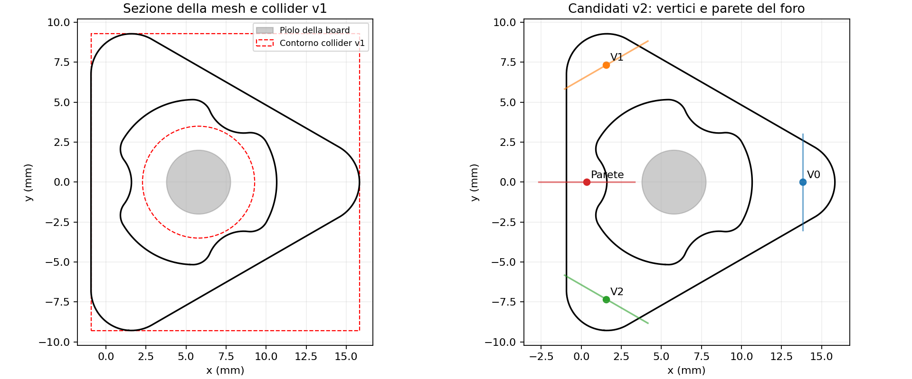

# Grasp v2: prima contatti realistici, poi apprendimento

La v1 ha completato L5 → R2 in 100/100 episodi con **presa assistita**. Rimane riproducibile con `bash peg_checkpoint1.sh play`.

**Ultimo risultato fisico v2:** il controller di PSM1 sulla parete ha raccolto 6/6 prese complete. `wall_bc2` arriva al peg ma resta nella chiusura; `wall_bc3` aggiunge feedback di pressione e deve essere verificato in Isaac. Sul vertice l'approccio riesce, ma anche la nuova centratura termina per spostamento del peg durante la chiusura.

Per la v2 ho esaminato la mesh USD del peg e i collider delle due dita. Il peg è un triangolo arrotondato di circa **16,8 × 18,6 × 17,2 mm**, alla scala attuale. Il foro ha un contorno sagomato. Il collider v1 usava invece un rettangolo esterno e un foro circolare: questo cambiava le superfici realmente toccate dalla pinza.



La nuova prova mantiene la mesh visiva e costruisce collider che seguono triangolo, foro e bordi arrotondati. Lo scarto radiale massimo **nei punti campionati** è 0,077 mm. È ancora un'approssimazione, composta da 672 celle convesse.

Sono disponibili due prese:

- **Vertice:** arrivo laterale, ganasce sui due lati del vertice. Si possono provare tre vertici e altezze diverse. Il giunto delle dita resta fuori dal triangolo.
- **Parete dall'alto:** un dito dentro il foro e uno fuori. La penetrazione iniziale è 1 mm sotto il bordo superiore. L'apertura è più piccola, per lasciare spazio al piolo della board.

Le pose iniziali perfettamente verticali/orizzontali hanno portato il polso al limite di yaw di ±30°. Ora la parete viene approcciata con la pinza inclinata di **20° dalla verticale**; il vertice con un ingresso di **30° sopra l'orizzontale**. Per PSM1 la direzione di chiusura è inclinata di altri 25° attorno all'asse della pinza. PSM2 usa la parete superiore destra; PSM1 quella sinistra. La figura mostra le zone di presa, mentre il controller usa queste orientazioni oblique.

Prima di avviare Isaac, il comando verifica l'arrivo delle dita e **72 punti del percorso**, includendo approccio, lift, abbassamento e ritirata. La cinematica usa i veri frame dei giunti USD, verificati contro le pose delle ultime tracce Isaac. I limiti restano quelli originali, con 2° di margine sui giunti rotativi e 1 mm sull'inserzione. Una scelta di vertice/altezza non compatibile viene rifiutata subito. Questo controllo non certifica collisioni lungo tutto il percorso o tenuta fisica: quelle richiedono la simulazione.

Il controllo comanda soltanto giunti e ganasce. Il peg viene mosso dai contatti fisici: non viene agganciato alla pinza né riposizionato durante il movimento. Ogni dito ha un sensore di contatto filtrato sul peg; toccare la board o il piolo non vale come presa.

**Limite attuale:** il corpo resta rigido, con contatti elastici e attrito. La mesh non si schiaccia come gomma. È il primo esperimento fisico della v2; per una deformazione volumetrica serviranno un modello deformabile e misure del materiale reale. I collider delle dita sono quelli del robot USD, anch'essi da confrontare con le pinze reali. Nessun risultato sim-to-real è verificato.

## Comandi

Con `conda activate PegTransfer`, dalla cartella del progetto:

```bash
bash peg_grasp_v2.sh tests
```

Prima prova sul desktop della workstation, con GUI e velocità reale:

```bash
bash peg_grasp_v2.sh probe --mode vertex --height 0.5 --episodes 1 --realtime
```

Poi la presa sulla parete:

```bash
bash peg_grasp_v2.sh probe --mode wall --episodes 1 --realtime
```

Il controllo segue ora una **traiettoria di posa assoluta**: riferimento a 25 mm/s nello spazio libero, 5 mm/s vicino al peg e durante l’abbassamento, **3 mm/s durante il lift**, rotazione fino a 1 rad/s nello spazio libero. Le velocità effettive dipendono dai giunti e dai contatti. Il riferimento può precedere la pinza soltanto di 3 mm nello spazio libero e 0,5 mm vicino al peg. Nella presa sulla parete la pinza resta sul ramo di orientamento senza il precedente giro di 180°; lo scambio fra dito interno ed esterno conserva la geometria campionata della presa.

Ogni fase ha un massimo di **6000 passi = 60 secondi simulati** a 100 Hz. Quando raggiunge il target, passa subito alla fase successiva; la tenuta richiesta resta di 2 secondi consecutivi. Se l'errore di posa non migliora per 5 secondi simulati, interrompe con `*_motion_stalled`, senza aspettare inutilmente tutto il budget. `--stage_steps` cambia il massimo per fase, non la velocità. `--free_speed`, `--contact_speed` (m/s) e `--rotation_speed` (rad/s) regolano il riferimento. `--lift_speed` (m/s) regola separatamente il sollevamento.

Il terminale mostra ogni secondo simulato **`phase_error`** (distanza dal waypoint della fase), **`grasp_distance`** (distanza dal punto di presa sul peg), **`rotation_error`** e i giunti vicini al limite. In `above`, un errore di fase quasi nullo può ancora significare che la pinza è circa 29 mm sopra il punto di presa: non è un successo di grasp. La soglia di arrivo resta 0,7 mm e 0,05 rad; non è stata allargata per nascondere un blocco.

La GUI viene aggiornata a 25 Hz, mantenendo fisica a 400 Hz e controllo a 100 Hz. `--realtime` aggiunge attese solo se il calcolo è più veloce del tempo simulato; non accelera una workstation che impiega più tempo a calcolare i passi.

Da SSH, prova senza finestra e con tre ripetizioni:

```bash
bash peg_grasp_v2.sh probe --mode vertex --height 0.5 --episodes 3 --headless
```

Senza `--vertex`, PSM1 prova il vertice 2 sul lato verso la propria base, PSM2 il vertice 0. `--vertex 0`, `--vertex 1` e `--vertex 2` permettono una scelta esplicita, che resta da verificare rispetto ai limiti del polso. `--height 0.2` e `--height 0.8` cambiano l'altezza della presa laterale. `--arm 2` permette di provare la seconda pinza sullo stesso peg L5. Non è ancora una prova di handover né una policy appresa.

Report e tracce sono in **`logs/grasp_v2/`**, con nomi diversi a ogni esecuzione. Un fallimento termina con un codice diverso da zero e viene conservato nel report. Il motivo distingue contatto insufficiente, mancato raggiungimento della posa, perdita della presa e forza eccessiva.

`bash peg_grasp_v2.sh inspect` rigenera la figura e il profilo a partire dagli USD locali, senza avviare Isaac Sim. La prova controlla gli hash di peg e robot prima di partire. Se il robot non è nella cache originale, passare lo stesso file locale sia a `inspect --robot_usd FILE` sia a `probe --robot_usd FILE`.

## Cosa conta come successo

La prova deve arrivare con la pinza aperta, chiudere con contatti su **entrambe** le dita, sollevare il peg di 35 mm e mantenerlo per 2 secondi. Il peg deve superare l'altezza dei pioli, restare quasi fermo e non scivolare rispetto alla pinza. Per la presa sulla parete viene richiesta anche la distinzione fra contatto interno ed esterno; sui vertici entrambi devono essere esterni. Infine il controllo abbassa il peg, apre e si ritira.

Nel report, `physical_grasp_hold_success` indica quante prove hanno superato il lift e la tenuta; `cases[].complete` comprende anche abbassamento, rilascio e ritirata. `complete` al livello principale indica che la raccolta dei risultati è terminata, anche quando le prove sono fallite. La tenuta non basta a certificare un trasferimento completo.

## Parametri iniziali, da calibrare

| Parametro | Valore |
|---|---:|
| Massa peg | 5 g |
| Attrito statico e dinamico di peg e dita | 0,9 |
| Rigidezza del contatto normale | 1000 N/m |
| Smorzamento del contatto | 0,5 N·s/m |
| Coppia massima per ganascia | 0,015 N·m |
| Rigidezza / smorzamento del drive delle dita | 0,6 N·m/rad / 0,02 N·m·s/rad |
| Forza normale cercata per dito | 0,35 N, banda ±0,05 N |
| Pressione stabile prima del lift | 0,4 s |
| Interruzione per forza normale | oltre 1 N su un dito |
| Physics / controllo | 400 Hz / 100 Hz |
| GUI | 25 Hz |
| Riferimento in spazio libero / vicino al peg / lift | 25 / 5 / 3 mm/s |
| Riferimento angolare in spazio libero / vicino al peg | 1 / 0,2 rad/s |
| Limiti simulati giunti rotativi / inserzione | 1,5 rad/s / 0,04 m/s |

Questi valori sono **ipotesi iniziali**, non misure della gomma reale. Il sensore riporta le forze normali; non misura qui la forza tangenziale totale. La rigidezza è una proprietà del contatto e non equivale al modulo elastico della gomma. I [contatti elastici di PhysX](https://nvidia-omniverse.github.io/PhysX/physx/5.5.1/docs/RigidBodyDynamics.html) usano una molla e uno smorzatore; la [deformazione volumetrica](https://docs.omniverse.nvidia.com/kit/docs/omni_physics/108.1/dev_guide/deformables/deformable_bodies.html) richiede un modello diverso.

## Correzione dello scivolamento — 5 ottobre 2026

Le prime tracce con le pose oblique confermavano l'arrivo al peg. Sulla parete il vecchio controllo iniziava il lift con circa 0,14–0,17 N sulle dita e perdeva i contatti entro circa 0,4 s. Sul vertice chiudeva fino a zero senza ottenere una pressione stabile su entrambe le dita; il peg si spostava rispetto alla pinza. In quelle prove la tenuta fisica non era verificata; il successivo risultato riuscito sulla parete è documentato sotto.

La nuova prova cerca **0,35 N su ciascun dito per almeno 0,4 s**, con contatti opposti nelle zone corrette e posizione del peg stabile rispetto alla pinza. Solo allora parte il lift. La coppia disponibile e la rigidezza del drive delle dita sono aumentate; la chiusura rallenta quando compare il contatto. Un dito più carico non fa aprire la pinza se l’altro ha ancora poca pressione.

Il lift parte verticalmente dalla posa realmente raggiunta, senza correggere lateralmente la pinza mentre stringe. Se la pressione cala, il movimento si ferma mentre le dita provano a recuperarla. La prova termina se i contatti mancano per 0,4 s, la pressione non torna entro 1 s, il peg scivola di 1,5 mm o ruota di 0,15 rad rispetto alla presa. Con dita chiuse senza pressione sufficiente termina dopo 1 s, invece di aspettare 60 s. Il successo richiede il lift completo di 35 mm e 2 s di tenuta.

L’attrito iniziale passa da 0,6 a **0,9**, un’ipotesi da calibrare, non un valore misurato della gomma. Il materiale delle dita e del peg viene assegnato **prima** dell’avvio della fisica, includendo il collider originale disabilitato del peg. Dopo l’avvio, il codice legge il buffer PhysX del peg: se l’attrito differisce, assegna i coefficienti tramite l’API dei materiali usata da Isaac Lab, senza cambiare la colonna della restituzione. Poi verifica di nuovo peg e quattro dita; se i valori non sono corretti interrompe la prova con i coefficienti effettivi nel messaggio. Questo evita di confondere il materiale scritto negli USD con quello effettivamente usato dal simulatore.

I log mostrano `force_N`, `paused` e `slip_mm`. Il report conserva i valori dell’attrito effettivo in `actual_physx_materials`. `grip_control` nella traccia contiene la decisione del controller presa prima del passo; forze e posa della stessa riga sono misurate dopo il passo. La capacità d’attrito stimata è soltanto un controllo preliminare sul peso: non certifica la tenuta dei contatti inclinati sui vertici.

Per confrontare l’attrito precedente mantenendo il nuovo controllo:

```bash
bash peg_grasp_v2.sh probe --mode wall --episodes 1 --friction 0.6 --realtime
bash peg_grasp_v2.sh probe --mode vertex --episodes 1 --friction 0.6 --realtime
```

**Stato:** 32 test CPU superati, compresi i campioni delle prese fallite, la pressione stabile, il recupero della presa, l’interruzione per scivolamento e la verifica dei materiali. Nessuna nuova simulazione o policy appresa eseguita per questa modifica. Prima verifichiamo la presa con i comandi standard sopra; poi procediamo a handover, dimostrazioni e training. La randomizzazione delle posizioni verrà dopo questa verifica.

## Arresto all’avvio durante la verifica dell’attrito

Le prove dell’utente delle 14:24–14:26 si sono interrotte con `Peg actual friction differs from requested friction`, prima della fase `settle`: i PSM non avevano ancora ricevuto comandi di movimento. Questi report contengono zero episodi e non misurano una presa.

Corretto il materiale di tutti i collider del peg e aggiunta l’assegnazione nel buffer PhysX quando necessaria, seguita dalla verifica. Il report distingue `initial_physx_materials` dai coefficienti finali `actual_physx_materials`. La GUI viene chiusa anche se questa inizializzazione fallisce. All’avvio deve comparire `PhysX friction verified on peg and four fingers`, poi il log delle fasi `settle` e `above`.

**Verificato:** 34 test CPU, inclusa una simulazione del buffer materiali con valori misti e un avvio simulato che fallisce e chiude ambiente/applicazione. Questi test non avviano Isaac Sim. L'esito della correzione sulla workstation resta da verificare con il normale comando `probe`.

## Parete riuscita; centratura del vertice — 5 ottobre 2026

Il [report della parete delle 14:37](logs/grasp_v2/wall_psm1_2026-10-05_14-37-08-243176.json) conferma **1/1 prese fisiche complete con PSM1**, senza aggancio assistito. Il peg sale di 34,9 mm; durante i 2 s di tenuta le forze mediane sono 0,344 e 0,304 N. Lo spostamento relativo massimo durante lift/hold è circa 0,009 mm. Anche abbassamento, rilascio e ritirata riescono. È una prova su L5 fisso, non ancora un trasferimento completo o un nuovo modello appreso.

Il codice esatto di questa prova, con hash corrispondente al report, è conservato in [wall_success1_2026-10-05_source.zip](logs/grasp_v2/wall_success1_2026-10-05_source.zip). Il [riepilogo misurato](logs/grasp_v2/wall_success1_2026-10-05.json) conserva metriche e hash. La presa sulla parete mantiene posa, apertura, pressione e materiali precedenti.

Sul [vertice delle 14:35](logs/grasp_v2/vertex_psm1_2026-10-05_14-35-12-590444.json), un dito tocca prima dell'altro e il peg si sposta di circa **2,5 mm durante la chiusura**, prima del lift. L'attrito effettivo di peg e dita è correttamente 0,9. Questo suggerisce un problema di geometria e centratura della presa; aumentare la forza da sola non corregge la spinta laterale.

La nuova prova sul vertice:

- entra 1 mm più in profondità sui fianchi (3 mm dall'apice), con apertura di 0,5 rad e twist PSM1 ridotto a 25°;
- cerca nella mesh una centratura che faccia toccare i due lati quasi insieme: per PSM1 a metà altezza, la correzione nominale è 0,5 mm lungo l'asse di chiusura;
- quando un dito tocca prima, ferma la chiusura e corregge la posizione della **pinza**, fino a 1 mm a 0,5 mm/s. Le ganasce restano accoppiate;
- interrompe se il peg si sposta di 1 mm durante la chiusura (`vertex_ejected_during_close`) o il contatto non si riequilibra entro 3 s (`vertex_contact_balance_not_recovered`).

Pressione richiesta, attrito, limiti dei giunti e criteri di lift/hold restano gli stessi. La centratura campionata non dimostra che i contatti reggano: serve la prova fisica. I log aggiungono `closure_shift_mm` e `centering_mm`; il report conserva la decisione finale del controllo anche in caso di interruzione.

**Verificato:** 41 test CPU; nuove pose nominali dei due PSM raggiungibili lungo 72 campioni ciascuna; controllo della parete identico su 2148 campioni della traccia riuscita. Evidenza in [vertex_centering_validation_2026-10-05.json](logs/grasp_v2/vertex_centering_validation_2026-10-05.json). Nessuna nuova simulazione avviata dall'agente; la tenuta della nuova presa sul vertice resta da verificare.

```bash
bash peg_grasp_v2.sh probe --mode vertex --episodes 1 --realtime
```

## Training v2: prima la presa wall di PSM1

Il [nuovo report del vertice delle 14:59](logs/grasp_v2/vertex_psm1_2026-10-05_14-59-11-945189.json) è ancora **0/1**: arrivo riuscito e pressione su entrambe le dita, poi interruzione `vertex_ejected_during_close` a 1,002 mm di spostamento del peg. Non è una dimostrazione riuscita e non viene usato per imitazione. La parete PSM1 resta la prima presa fisica verificata.

Il primo training **Behavior Cloning (BC)** usa le azioni del controller nelle prese wall complete. La raccolta delle 15:39 ha completato sei prove: **17.951 campioni**, con un episodio riservato alla verifica. Pose, forze normali sulle dita, apertura, riferimento corrente e fase vengono registrati **prima dell'azione**. La rete non riceve tempo trascorso, reward o etichetta di successo.

`wall_bc1` imparava direttamente quattro velocità: tre per il movimento e una per le ganasce. La sua traccia delle 15:51 mostra tre episodi arrestati in `above`, con circa **6,7 mm di errore**, orientamento già corretto, nessun giunto al limite e nessuna forza sul peg. Il comando della rete era quasi nullo. L'errore medio BC basso (0,00170) non aveva verificato l'arrivo al target. È poi arrivato anche il report JSON, che conferma tre arresti `above_motion_stalled`.

### Correzione dell'arresto prima della presa — 5 ottobre 2026

Il feedback sull'errore fra target e riferimento ora determina la direzione del movimento. La rete impara tre guadagni positivi (5–30 al secondo) e la velocità delle ganasce. Anche con il guadagno minimo, il comando continua verso il target; arrivato al target, si annulla. Restano i limiti di velocità e anticipo del riferimento, oltre alle pause per pressione debole. È un **controllo ibrido**, con feedback di posizione, scelta wall, orientamento, fasi, IK e controlli di scivolamento programmati. Non è ancora un agente che sceglie la presa o completa il trasferimento fisico.

Possiamo riutilizzare le sei dimostrazioni: osservazioni e azioni registrate mantengono lo stesso significato, e il codice fisico viene confrontato con la copia salvata in `wall_bc1/sources`. Il modello precedente fornisce le caratteristiche interne e il comando ganasce; le tre uscite del movimento vengono reinizializzate per imparare i guadagni. Dataset, modello precedente e prova wall originale restano conservati.

I comandi seguenti usano la versione corrente `wall_bc3`; la modifica di pressione e CUDA è descritta sotto. Nell'ambiente `PegTransfer`:

```bash
# 1. Training sulla RTX 6000; solo se wall_bc3 non è già presente.
bash peg_grasp_v2.sh train --device cuda:0 --demonstrations logs/grasp_v2/wall_demos_bc1.npz --initialize_from logs/grasp_v2/wall_bc2/policy.npz --output logs/grasp_v2/wall_bc3

# 2. Prima prova con la finestra Isaac sulla workstation.
bash peg_grasp_v2.sh probe --mode wall --policy logs/grasp_v2/wall_bc3/policy.npz --device cuda:0 --episodes 1 --realtime
```

I nomi di dataset e modello non vengono sovrascritti. Se la geometria o il controllo fisico cambiano, il riuso viene rifiutato e serve una nuova raccolta. I vecchi report senza osservazioni/azioni non vengono convertiti in dimostrazioni.

Parametri di `wall_bc2`: rete **128 + 128 neuroni**, 4000 aggiornamenti, batch 256, learning rate 0,0001. Il campionamento dà lo stesso peso alle fasi brevi e lunghe. Nei dati ci sono 41 pause del lift: il movimento viene fermato dal controllo della pressione, quindi quelle etichette non vengono usate per insegnare alla rete a fermarsi lontano dal target; il comando ganasce resta incluso. Dataset, parametri, errore sull'episodio riservato, codice e modello vengono conservati nella cartella del modello. Un errore BC basso non dimostra che la presa fisica riesca: serve il passo 2.

**Verificato per la correzione:** 50 test CPU, inclusi arrivo con ritardo del servo, riproduzione dell'arresto osservato e rifiuto di dati fisici incompatibili. Un controllo CPU di 100 aggiornamenti sui dati reali ha verificato training, esportazione e coerenza dell'inference NumPy/PyTorch. Non è una valutazione fisica: **nessuna nuova simulazione o tenuta della rete dichiarata**. Evidenza in [wall_bc2_validation_2026-10-05.json](logs/grasp_v2/wall_bc2_validation_2026-10-05.json).

## Parete bc3: pressione, CUDA e camera frontale — 5 ottobre 2026

La traccia delle 16:11 mostra `above`, `outside` e `reach` completati da `wall_bc2`, poi 25 secondi in `close`. Una delle dita resta intorno alla soglia di 0,30 N e la rete produce un comando ganasce quasi nullo; manca la pressione stabile per 0,4 s richiesta prima del lift. Non è ancora una presa appresa riuscita.

`wall_bc3` impara **guadagni positivi di posizione e pressione**. Quando una delle forze è sotto 0,30 N continua a chiudere; sopra 0,40 N su entrambe le dita scarica pressione; nella banda mantiene il comando. La rete varia la risposta fra 0,5 e 1,5 volte la velocità base. Il controllo resta ibrido, con feedback, scelta wall, fasi e orientamento programmati. Il controllo di contatto e slip decide quando il lift è ammesso: chiudere la pinza da solo non basta. Coppia, attrito, collider e materiale restano quelli della parete verificata.

Training e inference neurale usano CUDA. Il dataset, la rete, l'optimizer e il campionamento delle fasi restano sulla GPU; batch predefinito 1024, 4000 aggiornamenti, learning rate 0,0001. La CPU gestisce geometria, fasi e scrittura dei report. `--device cpu` è disponibile solo come scelta esplicita: il training predefinito rifiuta un fallback silenzioso quando CUDA non è disponibile.

La camera guarda la scena dal fronte dei PSM, inclinata verso la board: `eye=(0.025,+0.32,0.25)`, `target=(0.025,0,0.035)`, in metri. È configurabile con `--camera_eye X Y Z --camera_target X Y Z`; il cambio di camera non modifica la fisica o le dimostrazioni.

**Verificato:** 54 controlli del codice e quattro verifiche sulla RTX 6000 reale, compresi 100 aggiornamenti CUDA sui dati reali e inference sul campione bloccato. Il nuovo comando chiude mentre manca pressione. [Evidenza CUDA](logs/grasp_v2/wall_bc3_cuda_validation_2026-10-05.json). Nessuna nuova simulazione Isaac eseguita: tenuta e lift del modello restano da verificare con il comando sopra. Prima del task completo richiediamo tre prese complete consecutive, poi verifichiamo presa ricevente PSM2, handover e place senza agganci artificiali.

**Modello finale già salvato:** `logs/grasp_v2/wall_bc3/policy.npz`, addestrato sulla RTX 6000 per 4000 aggiornamenti, batch 1024, learning rate 0,0001, seed 42. Errore BC sull'episodio riservato: 0,001238. Verificata anche l'inference CUDA del checkpoint finale, con differenza massima rispetto all'audit NumPy di 0,000028 sulle azioni normalizzate. [Verifica del modello salvato](logs/grasp_v2/wall_bc3_checkpoint_cuda_validation_2026-10-05.json). Questo errore misura imitazione offline, non successo della presa fisica. È sufficiente eseguire il comando `probe` sopra; non serve rifare il training.

## Come scegliere la presa nel task completo

L'ipotesi **wall per PSM1 e vertex per PSM2** è da confrontare con alternative. La scelta dovrà usare posa del peg, foro accessibile, margine dei giunti, spazio libero fra i PSM e contatti misurati. Prima si eliminano i candidati irraggiungibili o in collisione; poi un modulo appreso potrà scegliere quello con maggiore probabilità di completare il trasferimento, tenendo conto anche dello scivolamento e del rilascio. Questo selettore non è ancora implementato o addestrato.

Percorso previsto: presa wall PSM1 appresa → presa ricevente PSM2 verificata e appresa → handover e place fisici → scelta fra più prese e randomizzazione delle posizioni. Un test PSM2 sul peg fermo sulla board è soltanto preliminare; non verifica la ricezione da PSM1:

```bash
bash peg_grasp_v2.sh probe --mode vertex --arm 2 --episodes 1 --realtime
```

## Checkpoint wall_bc3 verificato e video frontale

Il report delle 16:36 conferma **3/3 episodi completi senza aggancio assistito**, con lift 34,7–34,8 mm e tenuta ≥2 s. La visuale è stata girata sul lato opposto, Y positivo. È disponibile un [video dell'inference di un episodio](logs/grasp_v2/videos/wall_bc3_front_verified_2026-10-05.mp4) con esito positivo, 29,84 s, 1280×720, rendering RTX e codifica NVENC.

```bash
# Stesso modello, stesso codice originale; GUI sul desktop.
bash peg_grasp_v2.sh probe --mode wall --policy logs/grasp_v2/wall_bc3/policy.npz --device cuda:0 --episodes 1 --realtime
# Un nuovo video, anche da SSH.
bash peg_grasp_v2.sh video --device cuda:0
```

Modello, fisica, versione delle librerie e misure: [checkpoint2-wall-bc3](milestones/checkpoint2-wall-bc3.json). Il launcher verifica i sorgenti originali salvati prima di usarli; il codice successivo del task completo è separato. Il checkpoint copre la presa PSM1, non selezione autonoma della presa, randomizzazione o handover.

## Esperimento fisico completo wall/wall

Il primo candidato usa prese su due pareti diverse. Il vertice non ha ancora una presa fisica verificata; non viene usato come ricevente predefinito. Entrambe le pinze ricevono sempre comandi di posa e ganasce: il braccio donatore mantiene pressione anche mentre lavora il ricevente. Prima del rilascio PSM1 servono due contatti opposti, sulle superfici interna/esterna del foro, e pressione stabile su PSM2. Seguono tenuta PSM2 di 2 s, trasporto verso R2, inserimento, rilascio e stabilità misurata sulla board per 1 s.

La presa PSM1 può usare `wall_bc3`; il resto è un **controller fisico programmato da validare come insegnante**, non una nuova rete full già addestrata. Nella modalità predefinita non assistita non vengono usati comandi sulla posa del peg, giunti fissi o agganci magnetici. Ogni errore di contatto/slittamento interrompe la prova.

```bash
bash peg_grasp_v2.sh full --donor_policy logs/grasp_v2/wall_bc3/policy.npz --device cuda:0 --episodes 1 --realtime
```

Nuovi report `full_wall_*.json` e relative tracce in `logs/grasp_v2/`. Gli esiti sperimentali sono nella timeline. **Le prime sei prove hanno esito 0/6:** la presa PSM1 originale scivola durante la chiusura PSM2; le due prove con presa donatrice più profonda superano il limite di forza nel lift. Il comando sopra riproduce un esperimento ancora fallibile, non il checkpoint riuscito.

La chiusura ricevente bilancia i due contatti, limita la centratura a 1 mm e richiede 0,4 s di pressione stabile prima che PSM1 apra. `--donor_depth_mm`, `--receiver_depth_mm`, `--donor_open` e `--receiver_open` consentono esperimenti geometrici separati. `--donor_balance` sperimenta la stessa chiusura bilanciata sul donatore; `--donor_compliance` è una variante provata senza successo. Modificare la presa donatrice con `--donor_policy` viene rifiutato: il vecchio modello va usato con la propria geometria originale. Queste varianti non alterano il checkpoint salvato.

[Esiti e verifica dell'integrità del video e del modello](logs/grasp_v2/front_video_full_task_audit_2026-10-05.json). Prima di raccogliere dati per un nuovo training full serve un handover fisico stabile.

## Semplificazione temporanea per completare il trasferimento

La prima prova completa con assistenza ha esito **1/1**: [report](logs/grasp_v2/full_support_trial5_measured_receiver_2026-10-05.json). Il foro del peg termina a 0,412 mm dal post R2. PSM1 conserva la propria presa fisica, il lift di 35 mm e la tenuta di 2 s senza sostegno. In seguito un **giunto fisso PhysX temporaneo** mantiene il peg rispetto alla pinza che lo porta. PSM2 deve comunque costruire due contatti opposti sulla parete e mantenere pressione per 0,4 s prima del rilascio PSM1.

Il giunto viene eliminato **prima che PSM2 apra sul post R2**. Il successo richiede distacco di entrambe le pinze e stabilità libera sulla board per 1 s, foro allineato, post all'interno del foro, altezza corretta e bassa velocità del peg. Non vengono scritte direttamente posa o velocità dell'oggetto.

Il giunto è ideale: non ha un limite finito di forza o coppia. Questa è un'assistenza esplicita, non una prova di presa realistica. I limiti di forza sulle dita e di slittamento restano attivi; sotto il vincolo viene consentito il movimento anche quando manca pressione di mantenimento, e le deroghe vengono annotate nella traccia. L'acquisizione del vincolo richiede contatti opposti misurati; la chiusura PSM2 deve sempre passare il controllo fisico di preload.

```bash
# Esperimento completo assistito, GUI sul desktop della workstation.
bash peg_grasp_v2.sh full --donor_policy logs/grasp_v2/wall_bc3/policy.npz --device cuda:0 --peg_support 1 --peg_support_type fixed --peg_support_window carried --episodes 1 --realtime
```

`--peg_support 0` disattiva l'assistenza. `--peg_support_window handover` limita il vincolo alla chiusura PSM2 e al ritiro PSM1: questa variante ha esito **0/1**, con scivolamento PSM2 appena il sostegno viene rimosso. Non è ancora pronta per il training senza assistenza. Il sostegno elastico limitato (`--peg_support_type spring`) e i giunti con forza di rottura finita non hanno risolto il trasferimento nelle prove svolte.

Le nuove tracce complete includono stato misurato prima dell'azione, comando delle due pinze, obiettivo della fase, contatti e stato del vincolo. `audit_full.py` verifica sorgenti, precarico PSM2, tutte le fasi, limiti di forza e deposito libero prima di ammettere una raccolta riuscita.

**Verifica ripetuta: 3/3 episodi completi**, errore finale 0,298–0,433 mm e forza massima 0,623 N per dito. È riuscito anche l'episodio frontale registrato con seed 123: [video](logs/grasp_v2/videos/full_assisted_front_2026-10-05.mp4), 59,2 s, 1280×720 a 25 fps, rendering RTX e codifica NVENC. [Report 3/3](logs/grasp_v2/full_assisted_validation3_2026-10-05.json), [audit](logs/grasp_v2/full_assisted_validation3_audit_2026-10-05.json).

Il riferimento è conservato come [checkpoint3-full-assisted](milestones/checkpoint3-full-assisted.json). Il comando dedicato usa codice, modello donatore, scena e asset locali salvati, con verifica degli hash e delle versioni:

```bash
bash peg_grasp_v2.sh full-replay --check
bash peg_grasp_v2.sh full-replay --device cuda:0 --episodes 1 --realtime
bash peg_grasp_v2.sh full-replay --device cuda:0 --video
```

Conservare `.checkpoint_runs/checkpoint3-full-assisted/` e l'ambiente Isaac originale. Il training completo non è stato avviato: prima è stata verificata questa sequenza e distinta la parte appresa dalla semplificazione fisica temporanea.
